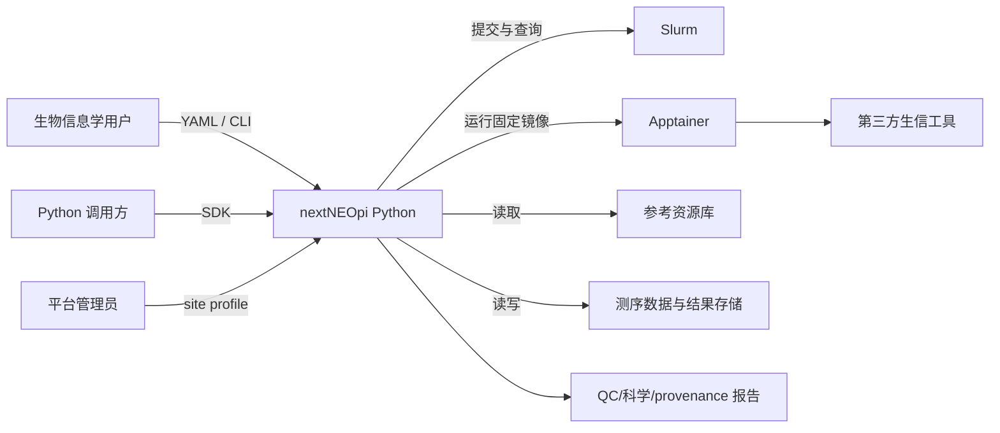
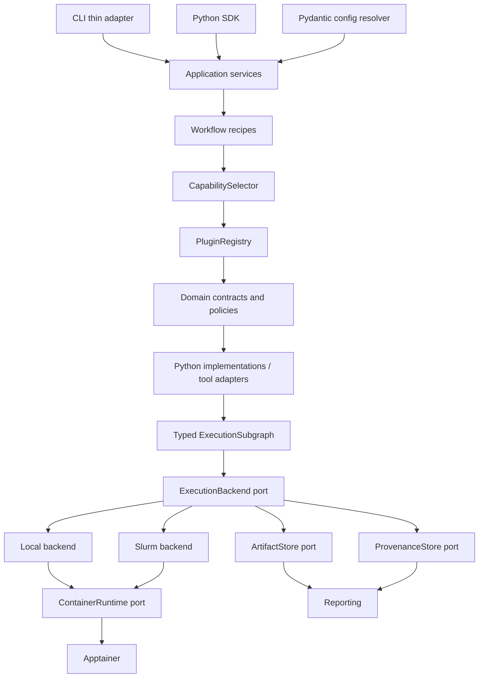
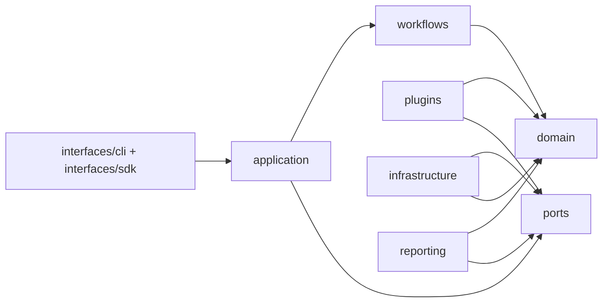
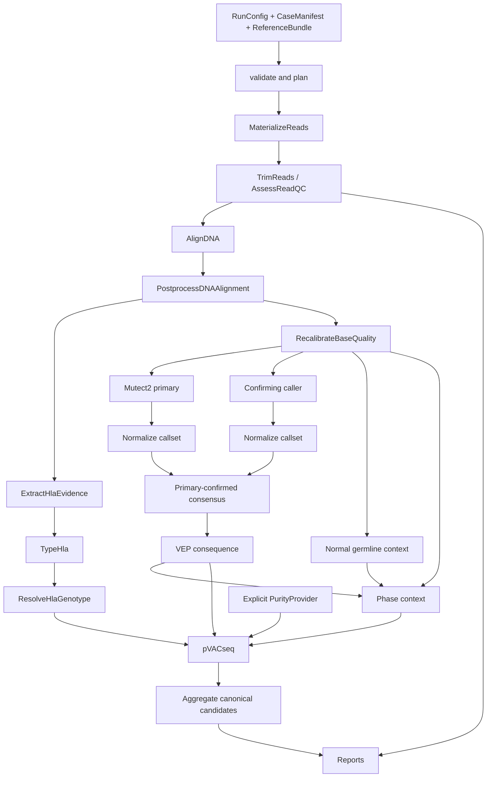

# 总体架构

## 架构目标

目标系统采用六边形架构。科学语义位于内层，配置、工作流引擎、Slurm、容器和文件系统均是可替换外部能力。任何第三方工具都不能绕过 adapter 直接污染领域模型。

## 系统上下文

## 容器视图

## 组件与依赖方向

规则：

1. `domain` 不依赖其他项目层，也不导入 Pydra/Snakemake、Slurm、Apptainer。
2. `application` 只通过 ports 操作执行、工件、插件和 provenance。
3. `plugins` 实现 capability contract；第三方 adapter 只能生成通用任务计划，不能直接提交 Slurm。
4. `infrastructure` 实现端口，但不能改变科学 policy。
5. CLI 是 SDK 的薄封装，不复制业务校验。

## 核心端口

| 端口 | 职责 |
|---|---|
| `ExecutionBackend` | 执行、查询、取消、resume 通用任务图；实现 local/Slurm。 |
| `ArtifactStore` | 原子提交、checksum、cache lookup、publish 和 garbage collection。 |
| `ContainerRuntime` | 根据 digest 和 mount 执行容器；正式运行必须离线。 |
| `PluginRegistry` | 通过 entry points 枚举、装载和校验插件。 |
| `CapabilitySelector` | 根据 request、descriptor、policy 解析实现并 fail-fast。 |
| `ProvenanceStore` | 保存 run/task/artifact/entity 关系、状态、参数和事件。 |

## 功能分组与实现边界

第一层按科学产物组织 7 个计算功能组，输入与运行管理提供病例、参考和调度，报告与发布负责汇总。各组由现有 `MOD-*` 和 `IF-*` 实现。第二层的算法编号标记可单独评估的环节，一个 capability 可用多个实现，同一旧工具也可能同时交付多个能力的工件。详见 [第一层设计](../02_modules/first-layer-functional-design.md)、[第二层算法清单](../02_modules/second-layer-algorithm-inventory.md) 和 [模块地图](../02_modules/module-map.md)。

迁移时按阶段保留 DNA BAM。HLA 的 DNA 取证消费重复标记后 BAM，Mutect2 消费重校准后 BAM。RNA 的 HLA 取证从准备好的 reads 分支，NeoFuse 使用已确定的 HLA 并一次交付 RNA BAM、TPM 和融合候选；迁移初期可共享此执行，再由不同 capability 交付结果。MiXCR 直接从 reads 独立分支。产物连接见 [Typed DAG Edge Matrix](../08_api_reference/typed-edge-matrix.md)。

## 首期数据流

首期将 purity 作为显式输入 capability。`configured: 0.95` 可用于首期 recipe，报告需记录来源。回放旧候选预测时注入同病例的实际纯度。定相结果带证据状态，未定相时按配置使用注释上下文。pVACseq 同时消费注释与可用的定相上下文。候选全量和过滤表用于首轮科学对照，聚合与初版报告继续作为交付工件。

## 运行与科学关注点分离

- **科学 hash**：输入内容、参考、implementation、科学参数、policy、schema。
- **执行信息**：CPU、内存、partition、account、scratch、重试次数。
- 资源变化通常不令科学缓存失效，但可能影响非确定性工具；插件可声明资源是否进入 cache key。
- site profile 不能覆盖科学参数。

## 状态模型

每个 capability 返回 `ResultEnvelope[T]`，状态为 `MATERIALIZED`、`EMPTY`、`NOT_REQUESTED`、`SKIPPED_UNSUPPORTED` 或 `FAILED`。空结果仍应具有 schema、producer 和 provenance；禁止依赖空 channel、`NO_FILE`、空数组或缺失文件推断状态。

## 相关文档

- [领域模型](domain-model.md)
- [工件模型](artifact-and-data-model.md)
- [工作流运行时](workflow-runtime.md)
- [模块地图](../02_modules/module-map.md)
- [接口约定](../03_interfaces/interface-conventions.md)
