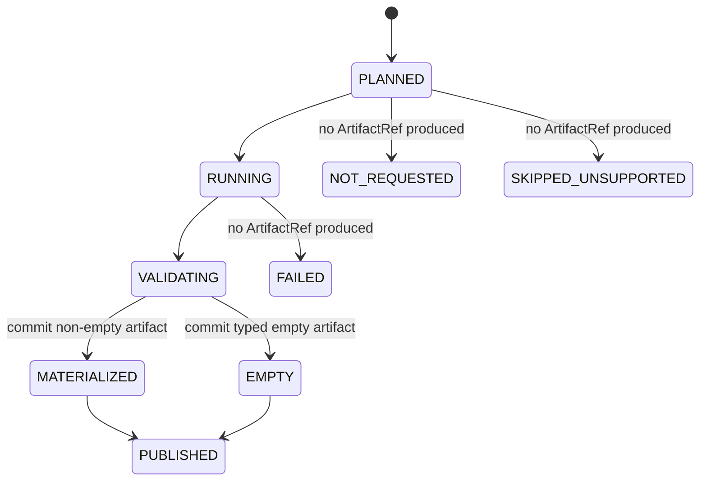

# 工件与数据模型

## 规范边界

工件是任务间唯一持久数据边界。`ArtifactRef[T]` **只表示已经通过校验并提交的工件**，因此其 `state` 仅允许 `MATERIALIZED` 或 `EMPTY`。未请求、不支持和失败并没有可信 URI/checksum，必须由 `ResultSlot[T]` 或最外层 `ResultEnvelope[T]` 表达，禁止制造假工件。

## `ArtifactRef` 唯一规范

| 字段 | 类型 | 说明 |
|---|---|---|
| `metadata_schema_version` | `Literal[1]` | Artifact metadata Schema 版本。 |
| `data_schema_version` | `SemVer` | 工件载荷/表结构版本。 |
| `artifact_id` | `ArtifactId` | 稳定 UUID/内容标识。 |
| `kind` | `ArtifactKind` | 如 `FASTQ_FILE`、`ALIGNED_BAM`、`VCF`。 |
| `uri` | `Uri` | 工件位置；路径不是身份。 |
| `media_type` | `str` | MIME/项目 media type。 |
| `checksum` | `Digest` | 默认 SHA-256。 |
| `state` | `ArtifactState` | 仅 `MATERIALIZED` 或 `EMPTY`。 |
| `case_id/sample_id/role` | optional IDs | 科学归属。 |
| `assay/reference` | optional typed values | WES/WGS、build/dictionary/坐标。 |
| `producer` | `ProducerIdentity` | capability/implementation/version/image。 |
| `parameter_digest` | `Digest` | 科学参数与 policy。 |
| `parents/companions` | artifact IDs | 血缘和 BAM/VCF 索引等伴随工件。 |
| `reason` | optional string | `EMPTY` 时必需。 |
| `created_at/published_uri` | timestamp/URI | 提交和可选发布位置。 |

JSON 规范见 [`../04_specifications/schemas/artifact.schema.json`](../04_specifications/schemas/artifact.schema.json)，必须由同一 Pydantic 模型生成或进行结构相等检查。

## `ResultSlot` 与 `ResultEnvelope`

```python
class ResultSlot(BaseModel, Generic[T], frozen=True):
    metadata_schema_version: Literal[1] = 1
    status: ResultStatus
    value: T | None
    reason: ResultReason | None
    provenance_id: ProvenanceId

class ResultEnvelope(ResultSlot[T], Generic[T]):
    """一个 capability 调用的最外层结果。"""
```

合法组合：

| `status` | `value` | `reason` |
|---|---|---|
| `MATERIALIZED` | 必需 | 可选 |
| `EMPTY` | 必需，内容/工件为空但 schema 合法 | 必需说明空的原因/口径 |
| `NOT_REQUESTED` | 必须为 `None` | 必需 |
| `SKIPPED_UNSUPPORTED` | 必须为 `None` | 必需 |
| `FAILED` | 必须为 `None` | 必需，关联错误/provenance |

复合 Result 的每个可独立成功、空、跳过或失败的字段必须使用 `ResultSlot[T]`，例如 RNA expression/HLA evidence、TMB metric、多个 scorer 和 report section。外层状态汇总规则由各 capability 明确。

Schema 见 [`../04_specifications/schemas/result-envelope.schema.json`](../04_specifications/schemas/result-envelope.schema.json)。

## 复合工件

- `FastqSet` 包含 R1/R2 `ArtifactRef[FastqFile]` 和 lane manifest。
- `BamWithIndex` 包含 BAM 与 BAI/CSI companion；缺任一项不可提交。
- `VcfWithIndex` 包含 VCF.GZ、TBI/CSI、sample order 和 dictionary digest。
- `ScatterSet[T]` 包含预期 shard IDs、每 shard `ResultSlot` 和 gather 顺序。
- `ReportBundle` 的每个 section 使用 `ResultSlot`。

若 adapter 需要读取复合工件的轻量描述，通过 `ArtifactStore.read_descriptor(ref, ModelType)` 获取；不得假定 `ArtifactRef` 有 `.value`，也不得把大文件整体载入 Python。

## 状态生命周期



## 提交、缓存与发布

写入 staging；collector 完成 schema、checksum、companion、shard 和科学不变量校验后原子提交。Cache key 包含 contract/implementation、镜像、父工件 checksum、reference、科学参数/policy 和 data schema。CPU/partition/account 默认不进入 scientific key；实现声明结果受线程影响时例外。

发布只是稳定视图，不改变 artifact identity。删除发布视图不破坏缓存；GC 不删除仍被 run manifest 引用的工件。

## 格式与坐标

VCF/BAM/FASTQ 保持交换格式；join 使用 typed identity。VCF identity 可映射 GA4GH VRS，但首期不替代 VCF。坐标转换必须显式且可测试，禁止散落 `pos - 1`。