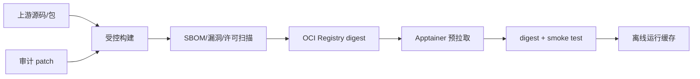

# 部署与容器

## 部署单元

- `nextneopi-core`：领域、应用、CLI/SDK 和 schema。
- capability 插件 Python distributions：通过 entry points 注册。
- tool images：单工具或紧密工具族 OCI 镜像。
- reference bundles：独立、只读、版本化资源。
- site profiles：由集群管理员维护，不进入科学 recipe。

## 容器策略

生产执行使用 Apptainer；镜像以 OCI source 和不可变 digest 标识。优先使用 BioContainers/Bioconda；HLA-HD、MiXCR、IEDB 等受许可或特殊安装工具使用受控私有镜像。镜像构建阶段应用必要 patch，记录来源与 patch checksum。

禁止：

- 正式 run 内 `curl/wget/git clone/pip install`；
- 以 mutable tag（如 `latest`）作为生产身份；
- adapter 修改仓库 `bin/` 或共享 reference；
- 使用 `curl -k` 绕过 TLS；
- 把 license 内容烘焙进可分发镜像。

## 供应链流程

## Mount 模型

- 输入与 reference：只读。
- task work/staging：读写、任务隔离。
- output publish：仅发布器写。
- license：最小只读 mount，路径不进入结果内容。
- `$HOME` 默认不透传；Apptainer 使用 clean environment。

`ContainerRuntime` 校验 host path、container path、权限和冲突。路径来自 typed mount，不拼接用户 shell 字符串。

## Local 与 Slurm

local profile 限制总 CPU/内存并使用本地 work/cache；Slurm profile 配置 account、partition、QoS、并发、状态查询频率、共享存储 latency 和 node-local scratch。科学 recipe 不包含这些站点信息。

## 参考资源

`ReferenceBundle` manifest 记录 build、版本、文件 checksum、contig dictionary、许可证和兼容工具。部署预检必须验证资源完整性；不允许“文件存在”替代版本兼容。资源升级产生新 bundle ID，不原地覆盖。

## 发布要求

每个 release 提供 Python wheel 锁定清单、插件清单、镜像 lock、reference bundle 要求、SBOM、许可证摘要、Schema 版本和迁移说明。