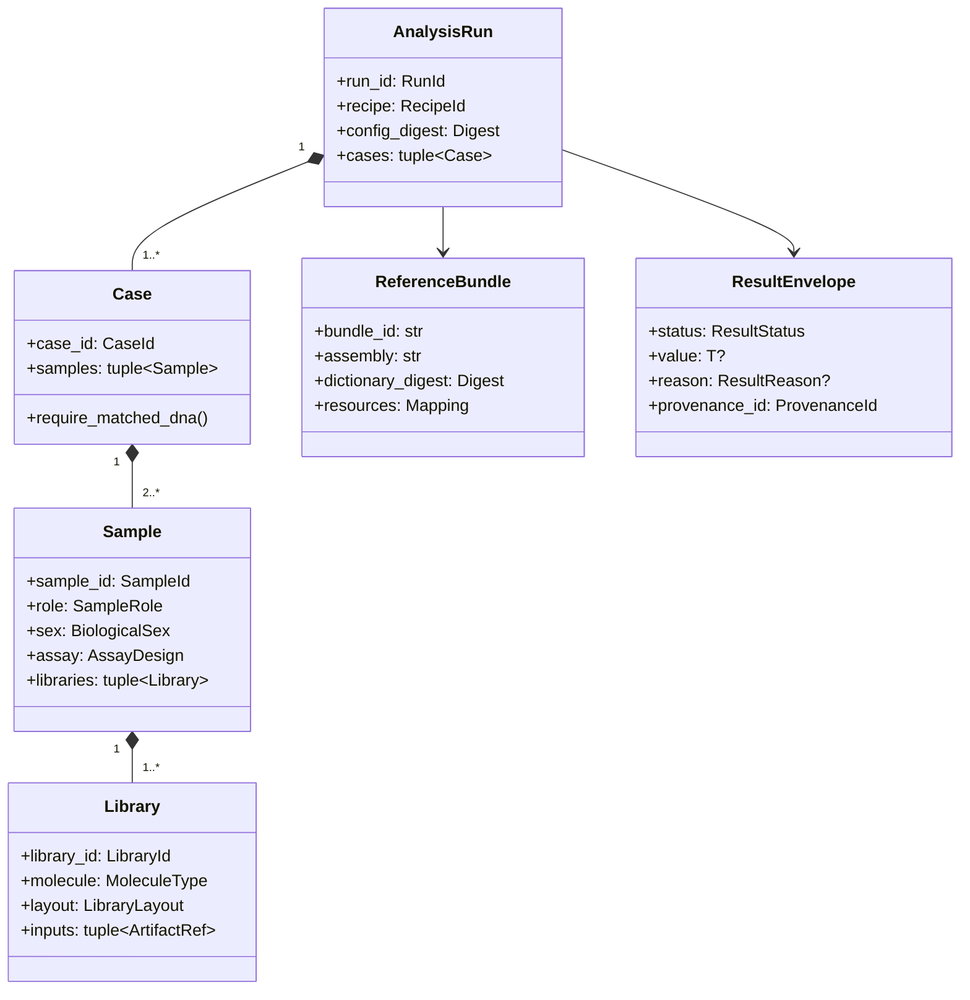

# 领域模型

## 设计原则

领域模型表达科学身份、约束和结果语义，不表达具体路径拼接、Slurm 参数或工具命令。大文件以 `ArtifactRef` 引用，领域对象不整体加载 BAM/VCF。

## 聚合与实体

## 核心值对象

| 类型 | 关键字段 | 不变量 |
|---|---|---|
| `CaseId` | 非空、受限字符 | 一个 run 内唯一，不直接来自不可信 shell 字符串。 |
| `SampleId` | 非空、受限字符 | 一个 run 内唯一；与 case identity 分离。 |
| `SampleRole` | `TUMOR_DNA/NORMAL_DNA/TUMOR_RNA` | 首期每 case 至少一对 tumor/normal DNA。 |
| `LibraryLayout` | `SINGLE_END/PAIRED_END` | 同一配对 DNA 的兼容性由 manifest policy 校验。 |
| `BiologicalSex` | `XX/XY/UNKNOWN` | 不把 unknown 强制映射到男性或女性参考。 |
| `AssayDesign` | `WES/WGS`、targets、callable policy | WES 必须声明 capture kit；WGS 不伪造 capture metrics。 |
| `GenomeBuild` | assembly、contig dictionary digest | join 的所有基因组工件必须相同。 |
| `CoordinateConvention` | 0/1-based、closed/half-open | 每个区间工件显式声明。 |
| `VariantIdentity` | build、sequence、position、REF、ALT | 必须在比较前 left-normalize/decompose；可映射 GA4GH VRS。 |
| `HlaAllele` | locus、fields、resolution、chain | class-II alpha/beta 关系不能丢失。 |

## 领域结果

- `ReadSet`：read 工件、layout、lane provenance、是否 trimmed。
- `AlignedBam`：排序、index、RG、duplicate/BQSR 状态和 reference。
- `SomaticCallset`：native/canonical 层、caller、variant kinds、sample schema。
- `ConsensusCallset`：primary identity、support set 和 policy version。
- `HlaCallset`：每条 call 的 locus、resolution、zygosity、evidence、quality。
- `CopyNumberProfile`：segments 及 `TOTAL_CN/ALLELE_SPECIFIC_CN/BAF/PURITY/PLOIDY` capabilities。
- `NeoantigenTable`：variant、transcript、consequence、peptide、HLA、MHC class、predictor evidence。

## 领域服务

纯 Python 服务包括 manifest 规则、callset normalization、consensus、HLA resolution、purity policy、CCF、TMB、候选 identity 和报告 section 状态。它们不得启动进程；外部工具通过 adapter 提供 native artifact，再由领域服务规范化。

## 不变量

1. 所有患者级 join 使用 `case_id`，所有样本级 join 使用 `sample_id + role`。
2. 不同 reference dictionary 的基因组工件不得 join。
3. `EMPTY` 是成功结果；`FAILED` 不得伪装为空表。
4. `NOT_MEASURED` 与数值 0 不等价，例如 RNA expression。
5. caller、HLA、CNV 和 phase capability 不得仅按共同文件后缀判定等价。
6. 每次 policy 决策必须生成 decision trace。

## 生命周期

配置解析产生不可变 `AnalysisRunSpec`；planning 解析插件并形成 `ExecutionPlan`；execution 只消费已验证计划；collection 产生 `ResultEnvelope`；publish 只复制/链接已提交工件。运行中不得修改科学配置。