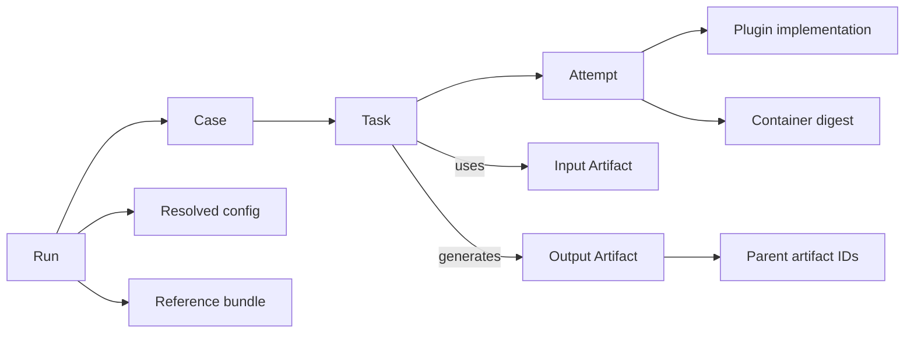

# Provenance 与可观察性

## 目标

任何发布结果都能回答：由哪个 case/sample、哪些输入、参考、配置、插件、容器和 task attempt 产生；为什么为空、跳过或失败；是否来自缓存。

## Provenance 实体

核心记录：

- run：ID、recipe、提交者、时间、配置 digest、代码版本。
- task：capability、implementation、scientific key、依赖、资源模型。
- attempt：backend job ID、主机/节点、开始结束、exit、错误类别、资源用量。
- artifact：checksum、schema、状态、parents、发布位置。
- decision：插件选择、HLA 仲裁、consensus support、purity fallback 等理由。

模型应可导出 RO-Crate 兼容结构，但首期以项目 JSON Schema 为稳定契约。

## 结构化日志

每条日志至少包含 `timestamp`、`level`、`run_id`、`case_id`、`task_id`、`attempt`、`capability`、`implementation`、`event`。不得输出 reads、完整 VCF 记录、license/token 或个人敏感字段。工具 stdout/stderr 单独保存并关联 attempt。

## 事件

标准事件包括 `RUN_PLANNED`、`TASK_SUBMITTED`、`TASK_STARTED`、`CACHE_HIT`、`TASK_RETRY`、`ARTIFACT_COMMITTED`、`TASK_EMPTY`、`TASK_FAILED`、`CASE_COMPLETED`、`RUN_COMPLETED`。事件追加写，不能覆盖历史 attempt。

## 指标

- task/run 成功率、失败类别和重试次数；
- queue wait、runtime、CPU/内存效率、scratch 峰值；
- cache hit ratio 和节省时间；
- case 吞吐与关键 stage 延迟；
- 各 implementation 的空结果率和 schema failure。

## 报告

执行报告与科学报告分离。执行报告展示状态、资源、日志和 provenance；科学报告展示 QC、variant、HLA、新抗原等 section。每个 section 必须显示 `MATERIALIZED/EMPTY/NOT_REQUESTED/SKIPPED_UNSUPPORTED/FAILED`，避免“报告缺块但 run 显示成功”。

## 保留与隐私

日志、provenance 和缓存保留期由 site profile 管理；删除必须保留审计记录。sample/case ID 在共享日志中可使用受控别名。未来接入集中监控时仍以本地 run bundle 为可移植事实来源。