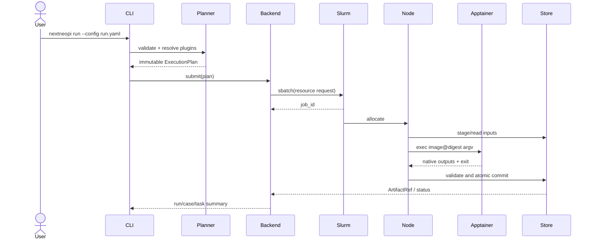
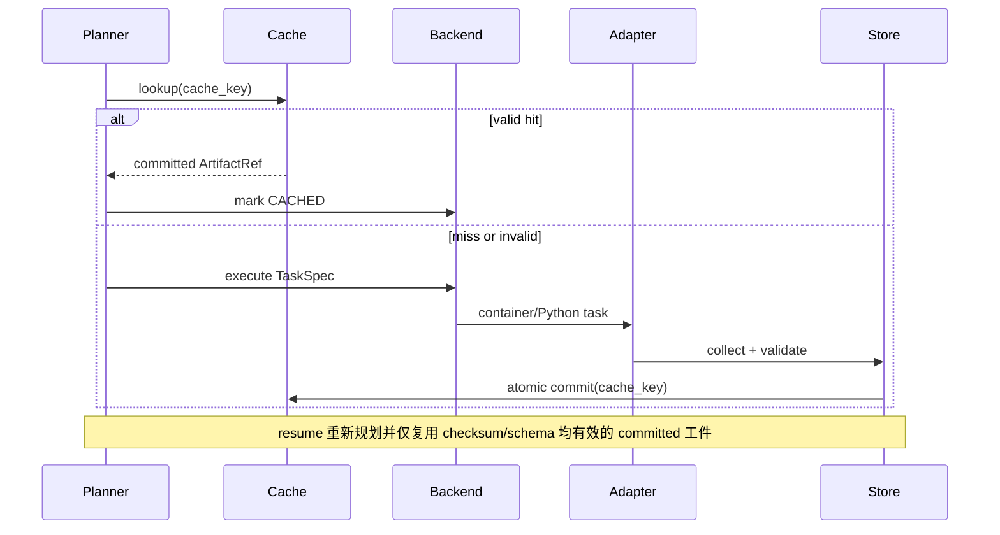

# 工作流运行时

## 执行后端策略

`ExecutionBackend` 隔离领域/插件与运行引擎。Pydra 是首选候选，因为其 Python 工作流、类型、split/combine、缓存、容器和 Slurm 方向匹配；但 1.0 当前仍为 alpha，必须完成真实环境 spike。强制门槛任一不满足时，改用 Snakemake backend；端口、工件和插件契约保持不变。

Parsl 适合 Python HPC，但异构单任务资源与生信工件语义需更多基础设施；Prefect 偏服务编排；CWL 作为未来互操作格式，而非首选内核。

## 强制验证门槛

- 本地与真实 Slurm 均执行同一 typed graph。
- 每任务 CPU/内存/时限/partition 可映射。
- Apptainer 每任务镜像与只读/读写 mount 可控。
- scatter/gather、动态分支、至少数千任务可用。
- cache/resume、失败重试、取消、超时和日志可观测。
- 单 case 失败可隔离；引擎异常后 run 可恢复。
- 共享文件系统 latency 和 node-local scratch 可配置。

## Slurm 执行时序

## Cache 与 resume 时序

## Scatter/gather

planning 阶段产生不可变 shard manifest。每个 shard 有稳定 ID、区间、预期输出和资源。gather 仅在 policy 允许的 shard 状态集合满足时运行；关键变异/BQSR 默认要求全量成功，不允许默默丢 shard。动态资源提升创建新 attempt，不改变 task scientific identity。

## 重试与失败分类

- `TRANSIENT_INFRASTRUCTURE`：节点失败、调度查询错误，可自动重试。
- `RESOURCE_EXHAUSTED`：OOM/timeout，可按 profile 增加资源后重试。
- `TOOL_ERROR`：工具非零退出，按 adapter policy 判定。
- `INVALID_INPUT`、`SCHEMA_VIOLATION`、`LICENSE_MISSING`：不可自动重试。
- `SCIENTIFIC_EMPTY`：成功，返回 `EMPTY`。

批次以 case 为故障域。必需主链失败使该 case 失败；可选支线失败记录 section `FAILED`，是否影响 case 由 recipe policy 决定。

## 运行状态

run、case、task、attempt 分层记录。`status` 命令必须可输出 JSON；`resume` 必须引用原 run ID 和新 attempt，并保存变更原因。取消只影响未提交工件；已原子提交的成功工件可复用。