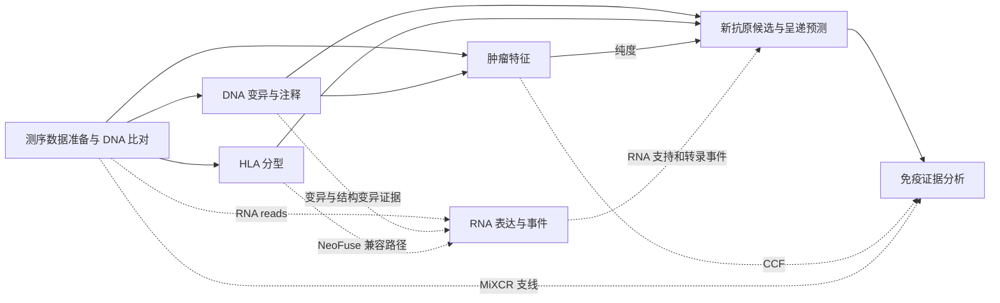

# nextNEOpi 第一层功能拆分与验证方案

第一层建议划分为 **7 个计算能力**，由输入与运行管理负责调度，由报告与发布负责汇总。每个计算能力都有明确的输入和可保存的输出，能够从保存的中间产物独立验证。现有 14 个 `MOD-*` 模块用于下一层细化。本方案基于对旧流程提交 `9f34698` 的静态检查，等价性仍需用实际运行结果验证。[设计基线](../README.md#已确认的设计基线) · [现有模块地图](module-map.md#模块一览)

## 第一层功能划分

| 第一层计算能力 | 职责 | 对外交付的产物 | 对应细模块 |
|---|---|---|---|
| A. 测序数据准备与 DNA 比对 | 接入 FASTQ/BAM，进行 reads 质控、DNA 比对、重复标记和重校准 | 规范化 DNA/RNA reads、各阶段 BAM/BAI、覆盖度和质控指标 | MOD-03～04 |
| B. DNA 变异与注释 | 检测体细胞和胚系变异，建立高置信共识，进行 VEP 注释与定相 | 各调用器 VCF、高置信 VCF、Manta 结构变异、注释 VCF、定相证据及状态 | MOD-05～06 |
| C. HLA 分型 | 汇总 DNA、RNA 和用户提供的分型证据，确定用于呈递预测的 HLA | Class I/II 分型、等位基因及配对、来源，以及补充预测所需的 HLA-HD 证据 | MOD-07 |
| D. 肿瘤特征 | 估计拷贝数、纯度和克隆性，计算突变负荷 | CNV 区段、纯度及来源、携带变异的癌细胞比例（CCF）、TMB 的突变数和可评估区域大小 | MOD-08～09 |
| E. RNA 表达与事件 | 进行 RNA 比对和表达定量，提取变异的 RNA 支持、融合与异常剪接证据 | RNA BAM/BAI、TPM、RNA 等位基因计数、融合和剪接事件 | MOD-10～11 |
| F. 新抗原候选与呈递预测 | 生成常规变异、融合和剪接候选，按 HLA 预测和过滤 | 按事件来源和 MHC 类别区分的全量表、过滤表和分数，以及 MixMHC2pred 补充预测结果 | MOD-12、MOD-13 的部分能力 |
| G. 免疫证据分析 | 为候选补充 CCF、参考蛋白匹配和免疫原性分数，并从 reads 独立分析受体库 | 候选证据表、CSiN/GBM 分数、MiXCR BCR/TCR 受体库 | MOD-13 的其余能力 |

输入与运行管理接收病例清单、参考资源和配置，安排任务执行（MOD-01～02）。报告与发布层消费各模块的结构化结果、指标和状态（MOD-14）。

每份交接产物记录病例 ID、样本角色、参考版本、产物类型、生成方法和状态。状态沿用草案中的 `MATERIALIZED`、`EMPTY`、`NOT_REQUESTED`、`SKIPPED_UNSUPPORTED`、`FAILED`。例如，没有检出候选属于成功但结果为空，未提供 RNA 的病例应保留并继续执行适用的 DNA 路径。[接口约定](../03_interfaces/interface-conventions.md#共享类型)

## 跨模块数据依赖

- **分别输出各阶段 BAM。** HLA 使用重复标记后的 DNA BAM，Mutect2 等调用器使用重校准后的 BAM。旧版 BAM 入口先转 FASTQ 再比对，直接复用已有比对结果需要单独验证。[BAM 入口](../../nextNEOpi.nf#L420) · [Mutect2 输入](../../nextNEOpi.nf#L1805) · [HLA 的 DNA 取证](../../nextNEOpi.nf#L4750)
- **RNA 证据与候选预测共用一次 NeoFuse 执行。** 旧 NeoFuse 接收 RNA reads、已确定的 HLA 和适用的 Manta 证据，一次产出 RNA BAM、TPM 和融合候选。编排层将 RNA 产物交给 E、将融合候选交给 F。RNA HLA 直接使用准备好的 reads，因此无需等待 NeoFuse 生成 RNA BAM。[RNA reads 分流](../../nextNEOpi.nf#L1030) · [NeoFuse 的输入和输出](../../nextNEOpi.nf#L5348)
- **常规候选显式接收注释、定相状态、HLA 和纯度。** 有 RNA 时附加表达及读段支持。纯度同时保留数值与来源，覆盖 ASCAT、Sequenza 及默认值路径。MiXCR 从 reads 独立启动。[纯度选择](../../nextNEOpi.nf#L4227) · [pVACseq 输入](../../nextNEOpi.nf#L5674) · [MiXCR 输入](../../nextNEOpi.nf#L6880)

## 验证步骤

1. **建立可回放的旧版基线。** 选一个能够产出非空常规候选的配对 WES DNA 病例，保存各边界中间产物和执行记录。固定旧版提交、实际生效的参数和调用器集合、工具或镜像版本、参考及索引、注释和模型版本。运行旧版时按项目说明固定 Nextflow `22.10.8`。README 提供的最小数据集适合验证流程能否跑通，需要设置 `--CNVkit false`。CNVkit 另外使用覆盖充分的病例验证。[旧版运行与测试数据](../../README.md#14-testdata) · [Nextflow DSL1 迁移说明](https://docs.seqera.io/nextflow/migrations/dsl1)
2. **以旧版产物逐块回放。** 将相同的旧上游产物送入新模块。例如，用同一份注释 VCF、定相状态、HLA 和实际纯度执行新候选预测模块，先比较全量和过滤候选表，再将结果接入旧后处理，检查上下游接口能否正常交接。
3. **补齐端到端场景。** 在相同输入与方法下运行新旧流程，先验收配对 WES DNA，再覆盖 BAM 输入、仅 Class I、无定相、零候选、工具失败和正常 RNA。用两个病例混跑，其中只有一个提供 RNA，检查候选和证据有没有串样或漏样。扩展 RNA 支持时覆盖 3′ tag，核对实际生效的过滤配置与剪接分支状态。[RNA 过滤与剪接分支](../../nextNEOpi.nf#L5728)

| 比较对象 | 通过条件 |
|---|---|
| reads 与 BAM | 样本角色、文件和索引配对、关键读段记录、比对坐标、标志位和覆盖指标符合约定。 |
| 变异与定相 | 用参考版本及规范化的 `CHROM/POS/REF/ALT` 对齐，核对过滤状态、深度、支持调用器、转录本注释和相位关系。 |
| HLA 与肿瘤特征 | 核对 HLA 等位基因、Class II 配对与来源，比较纯度来源和回退结果，核对 TMB 的突变数和可评估区域大小。 |
| 常规候选及后处理 | 按病例、事件、转录本、突变肽、HLA、MHC 类别和来源匹配，保留重复计数。候选身份、过滤去留和分支结果须一致。浮点分数按字段设容差，阈值两侧的入选判定须一致。纳入最终发布表的验收时，还要比较 CCF 与参考蛋白匹配结果。 |
| 报告 | 核对结构化指标、单位、结果状态与发布路径。压缩字节、无语义的行序和运行时间戳允许变化。 |

用小样例锁定两处旧行为。共识测试让主调用器和确认调用器在同一位置分别产生不同 ALT，记录旧版是否计入支持。CCF 测试让候选在 CCF 表中无精确匹配，检查前向填充是否带入另一位点的值。确认后如需改变科学规则，应记录预期差异，并为新规则保留独立的预期结果。[旧共识实现](../../bin/make_hc_vcf.py#L73) · [旧 CCF 合并](../../bin/add_CCF.py#L45) · [科学等价测试计划](../05_testing/scientific-equivalence-plan.md#分阶段比较)

## 首轮验收范围

首轮验收限定为 **配对 WES DNA → pVACseq 常规候选全量表和过滤表**。若新旧两边使用相同的调用器集合和纯度策略，可比较该范围内的整条流程。若按草案缩减调用器，或使用配置值提供纯度，应先验证新流程能接通。用旧版共识 VCF 与实际纯度回放时，等价结论从对应的交接点开始。要验收旧版最终发布表，再将 CCF 和参考蛋白匹配纳入对照。[增量迁移路线](../07_migration/incremental-roadmap.md#增量迁移路线)

第一份验收材料应包含一个 WES 病例的旧版边界产物、版本与参数记录，以及同一输入下新候选预测模块的差异报告。首期完整交付还包括聚合、初版报告和既有运行验收项。

模块与接口对应关系见 [模块地图](module-map.md) 和 [产物依赖矩阵](../08_api_reference/typed-edge-matrix.md)。需要替换具体算法时，查阅 [第二层算法清单](second-layer-algorithm-inventory.md) 和 [首批试点](../07_migration/incremental-roadmap.md#首批算法替代试点)。
