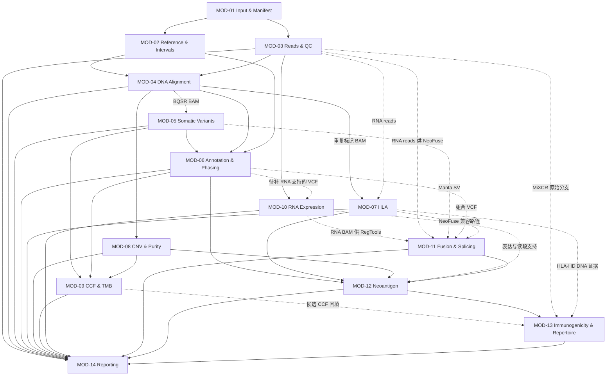

# 模块地图

## 第一层计算能力与第二层算法单元

[第一层功能设计](first-layer-functional-design.md)定义 A–G 的交接产物和等价验证范围。[第二层算法清单](second-layer-algorithm-inventory.md)为这七组列出 32 个可独立比较的算法单元。`MOD-*` 是已有实现设计和接口归属，一个模块可实现多个算法单元，也可支持不同计算能力中的一部分。

| 第一层计算能力 | 第二层算法单元 | 对应实现模块 |
|---|---|---|
| A 测序数据准备与 DNA 比对 | [A1 reads 与 QC、A2 比对、A3 重复标记、A4 BQSR 与覆盖](second-layer-algorithm-inventory.md#a-测序数据准备与-dna-比对) | MOD-03、MOD-04 |
| B DNA 变异与注释 | [B1 体细胞小变异、B2 共识、B3 SV 和候选 indel、B4 胚系、B5 注释、B6 定相](second-layer-algorithm-inventory.md#b-dna-变异检测注释与定相) | MOD-05、MOD-06 |
| C HLA 分型 | [C1 DNA 分型、C2 RNA 分型、C3 合并与配对](second-layer-algorithm-inventory.md#c-hla-分型) | MOD-07 |
| D 肿瘤特征 | [D1 CNV/纯度/倍性、D2 单变异 CCF、D3 TMB](second-layer-algorithm-inventory.md#d-拷贝数纯度克隆性与突变负荷) | MOD-08、MOD-09 |
| E RNA 表达与事件 | [E1 比对、E2 表达、E3 变异级 RNA 支持、E4 融合、E5 异常剪接](second-layer-algorithm-inventory.md#e-rna-表达融合与剪接事件) | MOD-10、MOD-11 |
| F 新抗原候选与呈递预测 | [F1 常规肽、F2 融合与剪接肽、F3 结合、F4 呈递、F5 补充分数、F6 过滤聚合](second-layer-algorithm-inventory.md#f-新抗原候选构建与呈递预测) | MOD-12，MOD-13 承接旧 MixMHC2pred 支线 |
| G 免疫证据分析 | [G1 参考蛋白匹配、G2 CCF 回填、G3 病例级汇总、G4 候选免疫原性、G5 免疫受体库](second-layer-algorithm-inventory.md#g-候选证据免疫原性与免疫受体库) | MOD-13，G2 依赖 MOD-09 的 CCF 表与回填规则 |

MOD-01 和 MOD-02 为计算能力提供输入及参考，MOD-14 汇总计算结果和运行状态。这三个支撑模块没有 A1–G5 的算法单元编号。

## 模块依赖

箭头表示经类型化产物传递的数据依赖，虚线标出可选路径或兼容路径。NeoFuse 兼容实现可一次产出 E 的 RNA BAM、TPM 和事件，以及 F 的融合候选。按产物分派到对应模块，可避免重复运行 STAR 和让 RNA HLA 等待 RNA 比对。 [第一层跨模块交接](first-layer-functional-design.md#跨模块数据依赖)

## 模块一览

| 实现模块 | 算法单元 | 首期 |
|---|---|---|
| [MOD-01 输入与 Manifest](MOD-01-input-and-manifest.md) | 输入支撑 | 是 |
| [MOD-02 参考资源与区间](MOD-02-reference-and-intervals.md) | 参考支撑 | 是 |
| [MOD-03 Reads 预处理与 QC](MOD-03-read-preprocessing-and-qc.md) | A1 | 是 |
| [MOD-04 DNA 比对](MOD-04-dna-alignment.md) | A2–A4 | 是 |
| [MOD-05 体细胞变异](MOD-05-somatic-variants.md) | B1–B3 | 是（M2 + confirming） |
| [MOD-06 注释与相位](MOD-06-annotation-and-phasing.md) | B4–B6 | 是 |
| [MOD-07 HLA 分型](MOD-07-hla-typing.md) | C1–C3 | 是，RNA 扩展后续 |
| [MOD-08 拷贝数、纯度与倍性](MOD-08-copy-number-and-purity.md) | D1 | 仅显式 configured purity，其余后续 |
| [MOD-09 CCF 与 TMB](MOD-09-ccf-and-tmb.md) | D2–D3，提供 G2 的变异级 CCF | 后续 |
| [MOD-10 RNA 比对与表达](MOD-10-rna-expression.md) | E1–E3 | 后续 |
| [MOD-11 融合与异常剪接](MOD-11-fusion-and-splicing.md) | E4–E5 | 后续 |
| [MOD-12 新抗原预测](MOD-12-neoantigen-prediction.md) | F1–F6，F5 的免疫原性分数可纳入 G4 的共同评估 | canonical 首期 |
| [MOD-13 免疫原性与免疫组库](MOD-13-immunogenicity-and-repertoire.md) | G1–G5，旧 MixMHC2pred 实现对应 F4 | 后续 |
| [MOD-14 报告](MOD-14-reporting.md) | 报告支撑 | 初版首期，逐步扩展 |

## 优先旁路试点

| 算法单元 | 候选方法 | 固定输入和验收 |
|---|---|---|
| A2 | BWA-MEM2 | 固定 reads、参考和后处理，核对逐条比对及下游变异，再比较耗时和内存 |
| C1 | SpecHLA | 固定 DNA 及参考，按独立分型真值比较各位点准确率、无结果率和 Class II 配对 |
| F3、F4 | NetMHCpan 4.2、NetMHCIIpan 4.3 | 冻结同一批肽–HLA 对，分别评估 BA 结合亲和力与 EL 呈递，比较覆盖和阈值影响 |

试点结果与旧方法并行记录。首轮科学对照覆盖配对 WES DNA 到 pVACseq 常规候选全量表和过滤表，首期交付还包含聚合、初版报告和既有运行验收项。 [试点验收](second-layer-algorithm-inventory.md#替换实验与验收) · [首轮验收范围](first-layer-functional-design.md#首轮验收范围)

## 统一模块规则

- 模块对外只暴露 `IF-*`；内部实现不可作为跨模块依赖。
- implementation 加入时必须注册 descriptor、配置、contract test 和一个 recipe。
- optional 输出使用 `ResultEnvelope`，不使用空路径。
- 模块风险与旧行为差异进入 [`../07_migration/risk-register.md`](../07_migration/risk-register.md)。
- 通用质量要求见 [`../06_quality/definition-of-done.md`](../06_quality/definition-of-done.md)。

## 现有到目标的入口

当前编排集中在 [`../../nextNEOpi.nf`](../../nextNEOpi.nf)；资源/参数在 [`../../conf/`](../../conf/)；算法胶水在 [`../../bin/`](../../bin/)；镜像、模型和补丁在 [`../../assets/`](../../assets/)。详细逐项映射见 [`../07_migration/current-to-target-mapping.md`](../07_migration/current-to-target-mapping.md)。
