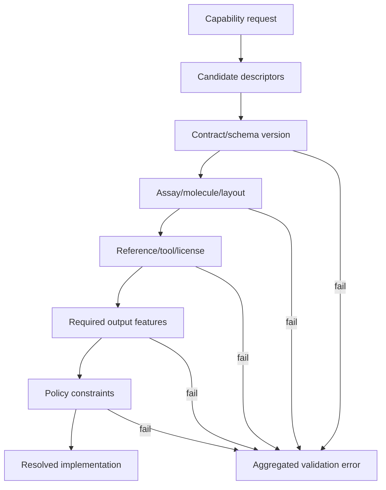

# Capability 模型

## 目的

Capability 描述“能完成什么科学职责”，implementation 描述“由哪个方法完成”。selector 只有在 request 与 descriptor 所有维度兼容时才能绑定实现。

## 核心维度

| 维度 | 示例 |
|---|---|
| assay | `WES`、`WGS` |
| molecule | `DNA`、`RNA` |
| layout | `SINGLE_END`、`PAIRED_END` |
| role | tumor、normal、matched pair |
| variant kind | SNV、INDEL、SV、CNV |
| MHC | class-I、class-II、paired chains |
| evidence | DNA、RNA、custom、read-backed |
| output feature | total CN、major/minor CN、purity、ploidy、BAF |
| protocol | full-length RNA、3' tag RNA |
| scatter | interval、sample、allele、none |
| empty behavior | accepted、rejected、typed empty |

## Descriptor 摘要

`PluginDescriptor` 包含 capability/implementation ID、contract/implementation version、supported dimensions、input/output schema、reference requirements、container digest、resource model、license、scatter 和 degradation rules。JSON 草案见 [`../04_specifications/schemas/plugin-descriptor.schema.json`](../04_specifications/schemas/plugin-descriptor.schema.json)。

## 选择算法

selector 不做隐式“最佳猜测”。配置指定 implementation 时不兼容即失败；配置允许优先列表时按明确顺序选择并记录 decision trace。

## 关键不可等价关系

- Mutect2、VarScan2、Strelka2、Mutect1 的 FILTER/AD/AF 和模型不同。
- Manta 提供 SV/candidate，不是普通 SNV caller。
- OptiType 主要 class-I；HLA-HD 可覆盖 class-I/II；custom 是外部证据。
- ASCAT/Sequenza 可提供 allele-specific CN/purity；CNVkit/FREEC 能力不同。
- read-backed phase 与 annotation-only phase 证据等级不同。
- pVACseq、pVACsplice、fusion predictor、MixMHC2pred 的输入与终点不同。
- 普通 RNA 和 3' tag RNA 不支持相同能力集合。

## 降级规则

降级只能由 policy 允许，且结果写入 `degraded_from`、`reason` 和 evidence level。必需 capability 不允许静默降级；例如首期 purity 未配置时失败，不能自动写 0.95。

## 测试矩阵

每个 descriptor 必须覆盖兼容和不兼容维度。最小负例：Manta+SE、OptiType+必需 class-II、CCF+total-CN-only、splice+3' tag、read-backed phase 无实现、MiXCR 无 license。