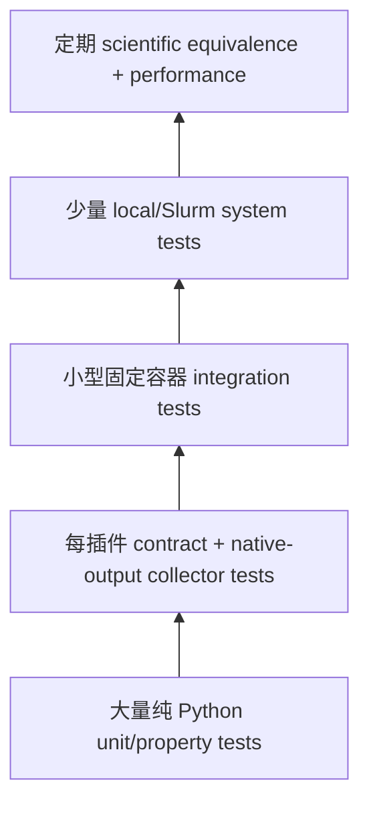

# 测试策略

## 目标

测试同时证明软件契约、运行可靠性和科学连续性。任何单一 E2E 通过都不能替代模块单测和 adapter contract；任何文件字节差异也不能直接判定科学失败。

## 测试金字塔

## 层级

| 层级 | 目的 | 数据 | 频率 |
|---|---|---|---|
| Unit | 领域不变量、policy、转换、数值 | 内存 fixture | 每次提交 |
| Contract | 所有实现遵守 IF/descriptor/collector | native output fixture、mock backend | 每次提交 |
| Integration | 固定镜像和真实工具链边界 | 微型参考/reads | PR 或每日 |
| System | 完整 recipe、状态和运行时 | 合成小数据 | 每日/发布 |
| Scientific | 旧行为刻画、同方法迁移等价、替代算法评测 | 小型边界工件、合成真值、独立公开/受控数据 | 按迁移单元和发布范围 |
| Performance | 吞吐、资源、扩展和调度压力 | 分层规模数据 | 发布前 |

## 重构验证顺序

1. 从旧流程捕获实际边界产物、参数和状态，用小样例刻画旧行为。
2. 使用同一份旧上游工件回放新模块，再接入旧下游验证交接。对齐工具、参考、模型和规则后比较科学结果。首轮在配对 WES DNA 中验证到 pVACseq 常规候选全量表和过滤表。
3. 基线可回放后，每次只切换一个算法，使用独立真值和预先约定的指标开展旁路评测。按适用范围记录性能、覆盖和下游候选变化。

设计交付记录计划、所需工件与待执行项。每轮运行后再记录实测结果和结论。首轮的发布条件依旧使用现有 ACC 门禁。参见[第一层功能拆分](../02_modules/first-layer-functional-design.md#验证步骤)、[第二层算法盘点](../02_modules/second-layer-algorithm-inventory.md#替换实验与验收)和[科学等价与评测计划](scientific-equivalence-plan.md)。

## 测试环境

- `unit`: 无容器、无网络、普通 CI。
- `container-smoke`: 固定 Apptainer 镜像、微型 reference。
- `local-e2e`: 单机限制 CPU/内存。
- `slurm-e2e`: 真实 site profile 和共享/scratch 存储。
- `benchmark`: 受控 HPC，保存工具/reference/version lock。

## 通用通过条件

- 测试可重复，随机数据固定 seed 并记录 generator version。
- 不访问未声明网络；不依赖用户 HOME 隐式状态。
- `EMPTY/NOT_REQUESTED/SKIPPED_UNSUPPORTED/FAILED` 均有正反例。
- fixture 有来源、许可、checksum 和 schema。
- 失败输出包含 run/case/task/attempt 和可行动原因。

## 缺陷策略

旧行为先以 characterization test 固化。经科学评审确认是缺陷后，添加“旧行为失败、新语义通过”的测试和 compatibility note，不为了形式等价复制错误。

## 追踪

测试 ID 前缀为 `TST-UNIT`、`TST-CONTRACT`、`TST-INT`、`TST-SYS`、`TST-SCI`、`TST-PERF`。每个测试映射 REQ/NFR、MOD/IF 和 ACC，汇总见 [acceptance-test-matrix.md](acceptance-test-matrix.md)。
