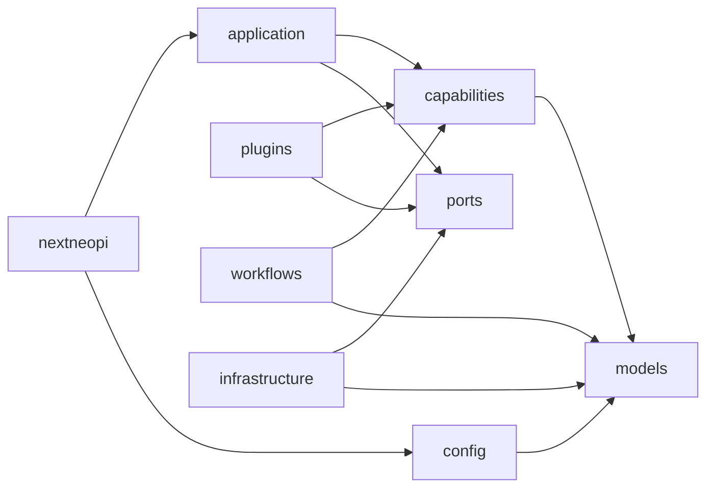

# 目标 Python Package 布局

```text
src/nextneopi/
├── __init__.py
├── config/
│   ├── models.py
│   ├── loading.py
│   ├── merging.py
│   └── migration.py
├── models/
│   ├── identity.py
│   ├── cases.py
│   ├── artifacts.py
│   ├── execution.py
│   ├── variants.py
│   ├── hla.py
│   ├── copy_number.py
│   └── neoantigens.py
├── application/
│   ├── client.py
│   ├── planner.py
│   ├── selector.py
│   └── recipes.py
├── ports/
│   ├── execution.py
│   ├── artifacts.py
│   ├── containers.py
│   ├── plugins.py
│   └── provenance.py
├── plugins/
│   ├── contracts.py
│   ├── descriptor.py
│   ├── registry.py
│   └── builtins/
├── capabilities/
│   ├── input_reference.py
│   ├── reads_qc.py
│   ├── alignment.py
│   ├── variants.py
│   ├── annotation.py
│   ├── hla.py
│   ├── copy_number.py
│   ├── ccf_tmb.py
│   ├── rna.py
│   ├── events.py
│   ├── neoantigens.py
│   ├── immunity.py
│   └── reporting.py
├── workflows/
│   ├── contracts.py
│   ├── registry.py
│   └── builtin/
├── infrastructure/
│   ├── backends/
│   ├── artifact_stores/
│   ├── containers/
│   └── provenance/
├── interfaces/
│   ├── cli/
│   └── sdk/
├── reporting/
└── errors.py
```

## 公共 namespace 与实现目录

公共 API 位于 `nextneopi`、`config`、`models`、`application`、`ports`、`plugins`、`capabilities` 和 `workflows`。`infrastructure`、`interfaces.cli` 的具体框架、`_internal` 不属于稳定 API。

## 依赖方向



`models/capabilities/ports` 不得导入 infrastructure；capability 不得导入具体 caller adapter；workflow recipe 不得拼第三方命令。

## 插件 distribution

第三方/独立插件建议命名 `nextneopi-<implementation>`，通过 `nextneopi.capabilities` entry point 暴露 factory。插件只依赖公开 API 和明确 contract version，不导入 core 内部目录。